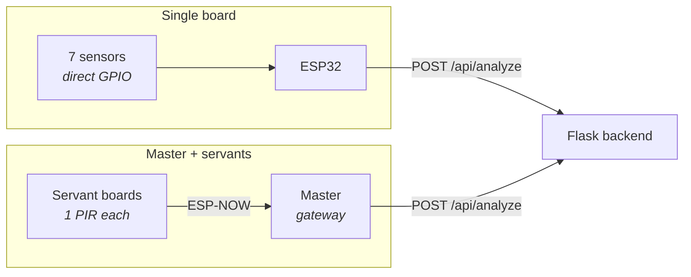

# IoT_Hardware

The ESP32 Arduino firmware — the only part of Safe House that touches physical sensors. Every sketch here does the same job: watch 7 zone sensors, and once every 60 seconds POST a snapshot of what fired to [`/api/analyze`](../Backend_Server/app/api/README.md) on the [Flask backend](../Backend_Server/README.md). Everything downstream — the anomaly model, the alerts, the weekly report — is fed entirely by this one minute-by-minute payload.

## Two deployment topologies

The same house can be wired either way; which sketch you flash depends on the building, not on any backend setting.

- **Single board** ([SafeHouse/](SafeHouse/)) — one ESP32 with all 7 sensors wired directly to its GPIO pins. Fewer parts and one thing to power, but every sensor needs a cable run back to the board, which is only practical in a small flat.
- **Master + servants** ([SafeHouse_Master/](SafeHouse_Master/) + [SafeHouse_Servant/](SafeHouse_Servant/)) — one gateway board plus one small board per zone, each talking to the gateway over **ESP-NOW** instead of cabling. Servants never join the WiFi network at all, so a zone only needs power, and only the master holds the WiFi credentials and the device token.



## What gets sent

Both the single board and the master POST the identical body once a minute, with the house's device token in an `X-Device-Token` header:

```json
{
  "house_id": "412ede6a-...",
  "time": "2026-05-20T14:30:00",
  "sensor_vector":    [0,1,0,0,0,0,1],
  "current_location": [0,0,0,0,0,0,1]
}
```

- **`sensor_vector`** — did sensor *i* fire *at any point* during the last minute. Not a count and not an instantaneous reading: interrupt handlers (or, on servants, ESP-NOW packets) set a flag, and the send cycle snapshots and clears all 7 flags atomically.
- **`current_location`** — a one-hot guess at which room the resident is in, held between cycles. It only moves when a *room* sensor fires; the door and the medication cabinet are point events, not places, so they deliberately don't relocate the resident. If nothing fires all minute, the location stays where it was — which is exactly what lets the model notice someone who hasn't moved in hours.

The sensor ordering (`0=Door … 6=Living Room`) is fixed and shared with the model's feature vector, the house's `sensor_mask`, and the app's sensor cards — see the [root README](../README.md#sensors-index).

## The sketches

### [SafeHouse/SafeHouse.ino](SafeHouse/SafeHouse.ino) — single board

Attaches a per-sensor interrupt to each of the 7 GPIO pins (`RISING` for PIRs, `FALLING` for reed switches wired to GND with `INPUT_PULLUP`), each handler marked `IRAM_ATTR` so it still runs during flash operations. The main loop does nothing until the 60-second mark, then snapshots the flags, updates the location estimate, and POSTs. On-board LED gives field feedback without a laptop: 1 slow blink = Normal, 3 fast = Warning/Emergency (read out of the response body), 5 rapid = the request failed.

### [SafeHouse_Master/SafeHouse_Master.ino](SafeHouse_Master/SafeHouse_Master.ino) — gateway

A pure hub with no sensors of its own. It registers an ESP-NOW receive callback that marks `sensorFired[msg.sensor_idx]`, and is otherwise the same 60-second snapshot-and-POST loop as the single-board sketch. On boot it prints its own MAC to serial — that value is what goes into every servant's `MASTER_MAC`.

### [SafeHouse_Servant/SafeHouse_Servant.ino](SafeHouse_Servant/SafeHouse_Servant.ino) — one per zone

Watches a single PIR and sends nothing but its own `SENSOR_INDEX` to the master. Two deliberate choices worth knowing before editing it:

- **No interrupts.** The pin is polled and edge-detected in `loop()` instead, because interrupts were queueing ghost triggers that fired after the fact.
- **A blocking wait after each trigger.** Once it sends, it delays 2s (riding out the WiFi power spike) and then spins until the pin physically returns LOW. A PIR whose sensitivity knob holds the line HIGH for 90 seconds will therefore freeze the board for those 90 seconds by design — it cannot re-trigger on a signal that never dropped.

At startup it scans for `ROUTER_SSID` to learn which channel the master is on and locks itself to it, falling back to `WIFI_CHANNEL` from config only if the scan finds nothing. It never associates with the router. If ESP-NOW init or peer registration fails it halts loudly rather than running silently deaf.

## Configuration and flashing

Each sketch folder has its own header holding everything installation-specific: [SafeHouse/config.h](SafeHouse/config.h), [SafeHouse_Master/config.h](SafeHouse_Master/config.h), [SafeHouse_Servant/config_servant.h](SafeHouse_Servant/config_servant.h).

**Master or single board:**

| Setting | Where it comes from |
|---|---|
| `WIFI_SSID` / `WIFI_PASSWORD` | The house's own network |
| `SERVER_URL` | The backend's `/api/analyze` endpoint |
| `HOUSE_ID`, `DEVICE_TOKEN` | Generated by the installer in the app's Create House flow — see [screens/admin](../front/safe_house_app/lib/screens/admin/README.md) |
| `TIMEZONE` | **Must be the resident's real zone.** The model uses local hour-of-day and day-of-week as features, so a wrong POSIX TZ string shifts their entire routine and makes normal behavior look anomalous. |
| `PIN_*`, `SENSOR_IS_PIR` | Your actual wiring (single board only) |

**Servants** — flash the master first, copy the MAC it prints into `MASTER_MAC`, then per board set `SENSOR_INDEX` to the zone it watches and `SENSOR_PIN` to the PIR's GPIO, and set `ROUTER_SSID` to the master's network.

Requires the ESP32 Arduino core and **ArduinoJson v6.x** (v7 changed the API these sketches use). Board: ESP32 Dev Module, upload at 115200 baud.

A house isn't marked Active in the backend until its first reading actually arrives, so powering the unit on is the last step of provisioning and its own confirmation that the config is right.

## Known rough edges

- **`config.h` files hold real credentials and are committed.** The single-board config in particular carries a live WiFi password, device token, and house ID. Treat any token that has been in this repo as compromised and rotate it from the admin app.
- **`MASTER_SENSOR_INDEX` / `MASTER_SENSOR_PIN`** are still defined in the master's config but referenced nowhere in the sketch. They're left over from when the master also owned the kitchen PIR; kitchen is a servant now.
- **The master stamps its timestamp with a trailing `Z`** while formatting *local* time. That's only accurate while `TIMEZONE` is `UTC0` — set a real zone and the timestamp will claim UTC for a local wall clock. The single-board sketch sends no suffix.
- **The two sketches disagree on location semantics.** The single board excludes both the door and the medication cabinet from moving `current_location`; the master excludes only the cabinet, so a door event relocates the resident to the door. The master also starts up assuming the door, the single board the living room.
- **`init`** is a leftover empty placeholder file, not used by anything.
