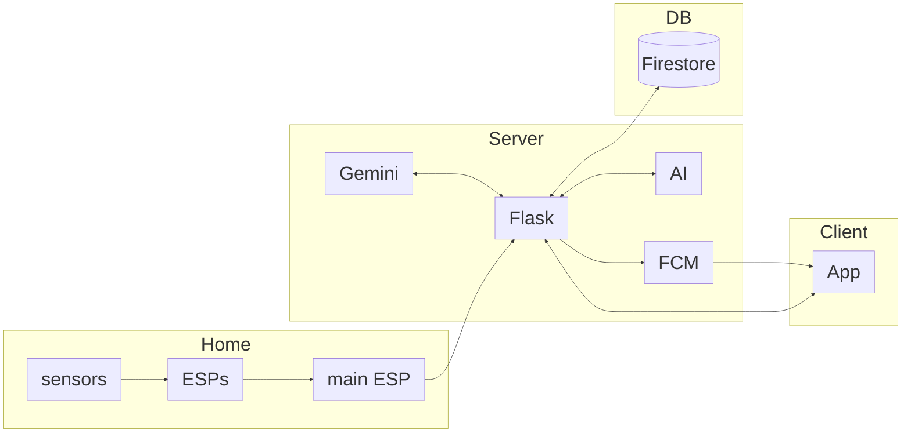

# Safe House

An IoT elderly-monitoring system. Motion and contact sensors placed around a resident's home report once a minute to a Flask backend, an LSTM Autoencoder learns that particular resident's normal daily routine, and anything that falls outside it — a bathroom visit that never ends, a morning with no kitchen activity, medication left untouched — becomes a push notification on their family's phones. Once a week, the same data is summarized into an AI-written wellness report.

The design constraint the whole system is built around: **no cameras, no microphones.** Every signal is ambient — a door opened, a bed occupied, a cabinet accessed — so the resident keeps their privacy while their family keeps their peace of mind.

YouTube link: https://youtu.be/PUYbugwY9Vg?si=zoO-TC4ajeanfxbf

## How it fits together

1. **Sensing** — an ESP32 master aggregates 7 zone sensors (its own plus servant boards over ESP-NOW) and POSTs a 7-bit `sensor_vector` plus a one-hot `current_location` every 60 seconds.
2. **Ingestion** — [`/api/analyze`](Backend_Server/app/api/README.md) authenticates the device token, appends the reading to an in-memory rolling buffer, and persists it.
3. **Detection** — once the buffer holds a full 6-hour (360-minute) window, a per-house fine-tuned [LSTM Autoencoder](AI_Model/README.md) scores it for three anomaly types: static location, missing usage, and high frequency.
4. **Alerting** — only a genuine *transition* to a different alert fires a notification, so a persisting anomaly doesn't re-notify every minute. The message is composed server-side and pushed via FCM.
5. **Reporting** — a Sunday job aggregates six wellness metrics (sleep, mobility, nutrition, hygiene, medication, socialization), compares them against the resident's own EMA baseline, and asks Gemini to write the narrative.

## Repository layout

| Folder | What it is |
|---|---|
| **[Backend_Server/](Backend_Server/README.md)** | The Flask backend — HTTP API, anomaly detection integration, alerting, scheduled jobs, and all Firestore access. Deployed as a single-worker gunicorn container. |
| **[AI_Model/](AI_Model/README.md)** | The LSTM Autoencoder: the scoring package the backend imports, the trained checkpoint and scaler, the Colab training notebooks, and a synthetic-scenario test suite. |
| **[front/safe_house_app/](front/safe_house_app/README.md)** | The Flutter mobile app, for both roles — family members watching a house, and installers provisioning one. |
| **[IoT_Hardware/](IoT_Hardware/README.md)** | The ESP32 Arduino firmware — the only part of the system that touches physical sensors. |
| **[front_demo/](front_demo/)** | The design prototype that preceded the real app — JSX/HTML screen mockups and an early UI-only Flutter scaffold. Not part of the shipping system. |
| **[logo/](logo/)** | Brand assets. |
| `server.txt` | A deploy manifest listing exactly which files the Docker build context includes. |

### Backend documentation tree

The backend is documented folder by folder: [`app/`](Backend_Server/app/README.md) (the Flask package and its scheduled jobs) covering [`ai/`](Backend_Server/app/ai/README.md), [`alerts/`](Backend_Server/app/alerts/README.md), [`api/`](Backend_Server/app/api/README.md), [`auth/`](Backend_Server/app/auth/README.md), [`monitoring/`](Backend_Server/app/monitoring/README.md), [`scheduling/`](Backend_Server/app/scheduling/README.md), [`state/`](Backend_Server/app/state/README.md), and [`weekly_summary/`](Backend_Server/app/weekly_summary/README.md) with its [`metrics/`](Backend_Server/app/weekly_summary/metrics/README.md) subpackage; plus [`database/`](Backend_Server/database/README.md) and its [`repositories/`](Backend_Server/database/repositories/README.md), [`entrypoints/`](Backend_Server/entrypoints/README.md), and [`scripts/`](Backend_Server/scripts/README.md).

### App documentation tree

Likewise for the app: [`lib/`](front/safe_house_app/lib/README.md) covering [`screens/`](front/safe_house_app/lib/screens/README.md) — [`auth/`](front/safe_house_app/lib/screens/auth/README.md), [`customer/`](front/safe_house_app/lib/screens/customer/README.md), [`admin/`](front/safe_house_app/lib/screens/admin/README.md) — plus [`services/`](front/safe_house_app/lib/services/README.md), [`widgets/`](front/safe_house_app/lib/widgets/README.md), [`theme/`](front/safe_house_app/lib/theme/README.md), and [`config/`](front/safe_house_app/lib/config/README.md).

### AI documentation tree

[`AI_Model/`](AI_Model/README.md) covering [`model_handler/`](AI_Model/model_handler/README.md) (the scoring package) and [`training/`](AI_Model/training/README.md) (the notebooks and why they use a weighted loss).

### Firmware documentation

[`IoT_Hardware/`](IoT_Hardware/README.md) covers all three Arduino sketches, the two deployment topologies (a single board with everything cabled to it, or a WiFi gateway plus one ESP-NOW servant per zone), the exact payload they send, and what has to go in each `config.h`.

## Sensors Index

The order below is fixed everywhere — the ESP32's `sensor_vector`, the model's feature vector, the house's `sensor_mask`, and the app's sensor cards all index into it identically.

| # | Zone | Typical sensor |
|---|---|---|
| 0 | Door | PIR |
| 1 | Kitchen | PIR |
| 2 | Bathroom | PIR |
| 3 | Toilet | PIR |
| 4 | Medications | PIR |
| 5 | Bedroom | PIR |
| 6 | Living Room | PIR |

A house that hasn't installed all seven marks the missing ones off in its `sensor_mask`, and every consumer — detection, weekly metrics, the dashboard grid — skips them.
